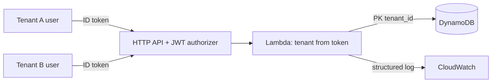

# Lab 2 — Multi-tenant serverless API

**Stack:** `infra/stacks/lab02_multitenant_api.py`. Implemented and evidenced. Evidence: `evidence/20261117T162612Z/`.

## Question

Given one pooled API and two tenants, where does the isolation boundary live, and what does enforcing it cost per request?

## Constraints

- `us-east-1`, sandbox account, **under $1**.
- No custom domain, no WAF, no multi-Region. None of them teach what this lab tests.
- No per-tenant KMS key. Logical isolation only; the KMS tier is priced in the interview line but not built.
- Deployed and destroyed inside one session. It validates the repo, the tags, the evidence capture, and the teardown on the cheapest stack available.

## Build

Cognito user pool with one app client and admin-managed groups `tenant-a` / `tenant-b`. **The app client is not the boundary; the group claim is.** The Lambda reads `cognito:groups` from the validated ID token, checks the path tenant to produce a deliberate 403, and builds the DynamoDB partition key from the token tenant only. The path tenant is never used as a data key.

The pool enforces a 12-character password policy with upper/lower/number/symbol; MFA is optional and OAuth flows are disabled because the evidence harness uses the admin auth flow.

DynamoDB is keyed `tenant_id` / `record_id` on on-demand billing. The partition key is tenant-scoped, so a handler that derives the key from the token cannot address another tenant's item. A condition expression would guard writes, not reads; the stronger read boundary is IAM `dynamodb:LeadingKeys` with per-tenant credentials, which this stack does not build.



## Deploy

```bash
just deploy 02     # preflight, synth, deploy, then capture evidence
just evidence 02   # re-run the tenant probes without deploying
just destroy 02    # destroy and assert no tagged resources remain
```

`deploy` runs the `scripts/evidence.d/lab02.sh` hook. It creates two users with generated passwords (never written), seeds one record per tenant, gets an ID token for each user, and calls the API three times.

## Failure to demonstrate

Tenant A's token requests tenant B's path:

- request: `GET /tenants/tenant-b/records/record-b` with A's token
- result: `403 {"error": "tenant_mismatch"}`
- log: `{"event": "tenant_mismatch", "tenant": "tenant-a", "path_tenant": "tenant-b", "record_id": "record-b"}`

The matching request `GET /tenants/tenant-a/records/record-a` with A's token returns 200. The 403 is deliberately chosen over 404 so the refusal is visible; 404 would reduce tenant enumeration but hide the boundary in the evidence.

## Evidence

`evidence/20261117T162612Z/` contains:

- `token-claims-a.json`, `token-claims-b.json` — decoded claims; raw JWTs are never written.
- `happy-a.status` = 200, `denied-a-to-b.status` = 403, `happy-b.status` = 200.
- `denied-a-to-b.body.json` — the `tenant_mismatch` response.
- `item-a.json`, `item-b.json` — the seeded records.
- `tenant-mismatch-logs.json` — the CloudWatch refusal line.
- `caller-identity.json` — redacted to `<account-id>` / `<caller-arn>`.
- `tagged-resources.json` — live resources only; stale tag-index entries filtered.
- `stack.json`, `cost.json`, `cost-total.txt`.

`cost.md` carries the actual spend and the teardown timestamp.

## Interview line

Logical isolation is cheap: one claim check plus a tenant-scoped partition key. Its weakness is that every data access path must derive the key from the token; one path that trusts the request reopens the boundary. A per-tenant KMS key makes the boundary cryptographic, but adds key policy, grants, and encryption/decryption work. That cost protects against a compromised handler with broad table permissions, not against a wrong claim check.

## Exam mapping

1.1.13 (multi-tenant isolation), 2.1.2–2.1.3 (identity and authorization), 2.2.1 (encryption), 3.3.1 (cost).
