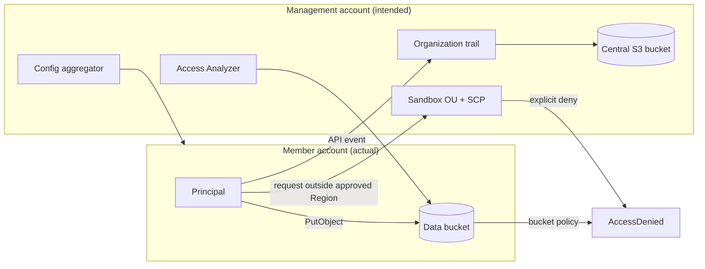

# Lab 3 — Multi-account governance

**Stack:** none. Artifact-only because `AWS_PROFILE=arch` is a member account without Organizations administration. Evidence: `evidence/20261118T171406Z/`.

## Question

Which control actually stops the action — the SCP, the resource policy, the permission boundary or the guardrail service — and what evidence does an auditor get when it fires?

## Gate result

`organizations:DescribeOrganization` succeeds, so the account is in an organization. `organizations:ListRoots` and `organizations:ListPolicies` return `AccessDeniedException`, so the project profile cannot create a sandbox OU, attach a new SCP, or create an organization trail. The management account is not reachable from this profile.

Per the lab rules, this is the documented blocked path: reviewed policies under `artifacts/`, denied API calls under `evidence/`, and no stack. `design.md` carries the control-order analysis and the management-account runbook.

## Constraints

- **No changes to existing SCPs or org-wide services.** The intended SCP is attached to a new sandbox OU, then removed.
- Cost cap **under $2**. CloudTrail and Config only; **no Security Lake**, no org-wide GuardDuty.
- If the account has no Organizations administration, do not fake it: produce the SCP, trail policy and bucket policy as reviewed JSON plus a design note, and record the blocked API call.
- **Do not enable a Config recorder outside this lab.** The account's existing `default` recorder is stopped; this lab does not start it.

## Build (intended)

- Sandbox OU with `artifacts/scp-deny-region.json` attached. The SCP denies actions outside `us-east-1` / `us-west-2`, except global services, and denies `organizations:LeaveOrganization`.
- Organization CloudTrail trail into a central S3 bucket. `artifacts/trail-bucket-policy.json` restricts writes to the trail, rejects writes outside the trail's home Region, and denies insecure transport.
- `artifacts/data-residency-bucket-policy.json` as the data-plane backstop for a bucket in a non-approved Region.
- Config recorder and aggregator, IAM Access Analyzer, and one AWS Artifact report.
- No stack is registered for this lab, so `just deploy 03` is intentionally unavailable.



## Deploy

No stack. Capture the blocked gate and the current controls:

```bash
just evidence 03
```

`evidence.sh` writes the common identity, tag, and cost records; `scripts/evidence.d/lab03.sh` captures the Organizations denials, the organization trail, the stopped Config recorder, the Access Analyzer state, and one Artifact report's metadata and hash.

## Failure to demonstrate

The SCP cannot be attached from this account. The observed failure is the blocked administration API:

```text
organizations:ListRoots   -> AccessDeniedException
organizations:ListPolicies -> AccessDeniedException
```

In a management account, the expected failure is a member-account request such as `s3api create-bucket --region eu-west-1` returning `AccessDenied` from the SCP, with the denied event visible in the organization trail. `design.md` lists the full test sequence.

## Artifacts

- `artifacts/scp-deny-region.json` — region and leave-organization SCP.
- `artifacts/trail-bucket-policy.json` — CloudTrail bucket policy.
- `artifacts/data-residency-bucket-policy.json` — data-plane region and transport policy.
- `design.md` — control order, overlap analysis, management-account runbook, teardown.

## Evidence

`evidence/20261118T171406Z/` contains:

- `organizations-describe-organization.json` — organization ID and feature set; management account redacted.
- `organizations-list-roots.err`, `organizations-list-roots.status` — blocked `ListRoots` call.
- `organizations-list-policies.err`, `organizations-list-policies.status` — blocked `ListPolicies` call.
- `cloudtrail-trails.json` — the organization trail exists; the bucket name is account-redacted.
- `config-recorder-status.json`, `config-recorders.json` — the `default` recorder exists but is not recording.
- `access-analyzers.json` — no analyzers configured.
- `artifact-report.json` — SOC 2 report metadata, byte count, and SHA-256. The PDF is not committed because AWS Artifact reports are confidential.
- `stack.err` — no `SapC03Lab03` stack exists.
- `caller-identity.json`, `tagged-resources.json`, `cost.json`, `cost-total.txt` — common evidence records.

`cost.md` carries the spend and the no-deploy note.

## Interview line

The SCP fires first: an explicit deny is evaluated before identity and resource policies, so the request never reaches the bucket. The bucket policy is the data-plane backstop if the SCP is detached or the bucket exists in the wrong Region. CloudTrail and Config record what happened after the fact; they do not stop it. Duplicating the same region deny in both controls is deliberate defense in depth, but you cannot observe both on one request because the first deny wins. Test the bucket policy with an identity outside the SCP or a bucket in a non-approved Region, and keep CloudTrail for the audit trail.

## Exam mapping

2.3.1–2.3.6 (governance and controls), 2.4.2–2.4.5 (compliance and data residency), 5.1.1–5.1.4 (IaC and config management).
