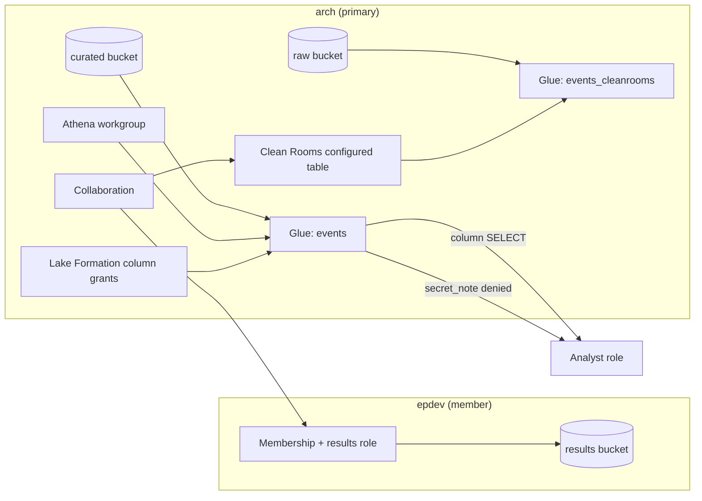

# Lab 4 — Lakehouse and Clean Rooms

**Stack:** `infra/stacks/lab04_lakehouse.py` in `arch`, `infra/stacks/lab04_member.py` in `epdev`. Implemented and evidenced. Evidence: `evidence/20261118T180045Z/`.

## Question

Where does the data boundary live in a lakehouse — the bucket policy, the Lake Formation grant, or the query engine — and what does a denial look like to the analyst who hits it?

## Constraints

- `us-east-1`, sandbox accounts, **under $2**.
- Glue Data Catalog and Athena only; no EMR cluster.
- Clean Rooms needs a second account. This lab uses `arch` as the collaboration creator and `epdev` as the results receiver.
- The second account is disposable. All lab resources carry `Project=sap-c03-labs`, `Lab=04`, `Owner=steven`, `TearDown=<date>`.

## Build

- `arch`: raw, curated, and Athena-results S3 buckets; Glue database; Athena workgroup with a 10 MB scan cap; analyst and Clean Rooms IAM roles.
- The analyst role is granted only `event_id`, `user_id`, `category`, and `amount` by Lake Formation. `secret_note` is deliberately withheld.
- The evidence script creates an Iceberg table at `s3://<curated>/iceberg/`, inserts six rows, and captures the snapshot list.
- `epdev`: a results bucket and a Clean Rooms results role. The member joins the collaboration and receives the aggregate query results.

### Why there are two Glue tables

Clean Rooms rejects a Glue table that Lake Formation manages:

```text
ValidationException: Table: events is managed by LakeFormation and is not currently supported by AWS Clean Rooms.
```

The stack therefore keeps the boundaries separate:

- `events` over `s3://<curated>/events/` is registered with Lake Formation and is the table the analyst queries. The column grant is the boundary.
- `events_cleanrooms` over `s3://<raw>/cleanrooms/` is not registered with Lake Formation and is the configured table Clean Rooms reads. The configured table's `allowedColumns` list is the boundary.

That is the operational answer to the question: Lake Formation governs the Athena path; Clean Rooms governs the cross-account aggregate path. They do not compose on one table.



## Deploy

```bash
just preflight
just deploy 04          # primary stack, member stack via the evidence hook, evidence
just evidence 04        # re-capture without redeploying
just destroy 04         # Clean Rooms cleanup, member stack, primary stack, cost record
```

`just deploy 04` deploys `SapC03Lab04` in `arch`, then `scripts/evidence.d/lab04.sh` deploys `SapC03Lab04Member` in `epdev` if it is absent and runs `scripts/lab04_cleanrooms.py`.

The two-account driver uses `SAP_LABS_PRIMARY_PROFILE=arch` and `SAP_LABS_SECONDARY_PROFILE=epdev`; the second account is never selected by an ambient `AWS_PROFILE`.

## Failure to demonstrate

Lake Formation denies the hidden column to the analyst:

```text
COLUMN_NOT_FOUND: Column 'secret_note' cannot be resolved or requester is not authorized to access requested resources
```

The same column is absent from the Clean Rooms configured table, so the protected query fails before the data plane:

```text
Query is invalid. Column 'secret_note' not found in any table.
```

The allowed paths return the same aggregate:

```text
category,events,total
books,3,35.0
music,3,85.0
```

## Evidence

`evidence/20261118T180045Z/` contains:

- `athena-admin-count-results.csv` — the unrestricted count.
- `athena-analyst-allowed-results.csv` — the column-granted aggregate.
- `athena-analyst-denied.json` — the Lake Formation `COLUMN_NOT_FOUND`.
- `athena-iceberg-create.json`, `athena-iceberg-insert.json`, `athena-iceberg-snapshots-results.csv` — the Iceberg table and its append snapshot.
- `lakeformation-settings-before.json`, `lakeformation-settings-admin.json`, `lakeformation-permissions.json` — the grant state.
- `cleanrooms-summary.json` — collaboration, memberships, configured table, and association IDs.
- `cleanrooms-query.json` — the successful protected query.
- `cleanrooms-result.csv`, `cleanrooms-result-location.json` — the aggregate delivered to the `epdev` results bucket.
- `cleanrooms-denied.json` — the configured-table column rejection.
- `stack.json`, `caller-identity.json`, `tagged-resources.json`, `cost.json`, `cost-total.txt` — common evidence records.

`cost.md` carries the actual spend and the teardown timestamp.

## Interview line

IAM and S3 policies are coarse: they gate the bucket and the API, not the column. Lake Formation adds column-level grants on the Athena path, but the principal still needs `GetDataAccess` and the engine must honor the grant. Clean Rooms adds a different boundary: the configured table exposes only approved columns and only aggregate queries, and the second account receives results without ever seeing rows. The operational price is the second account, the invitation/membership, two service roles, a results bucket, and two Glue tables because Clean Rooms will not consume a Lake Formation-managed table. One table cannot carry both boundaries.

## Exam mapping

1.5.1–1.5.7 (data and analytics architecture), 3.4 (storage and analytics cost).